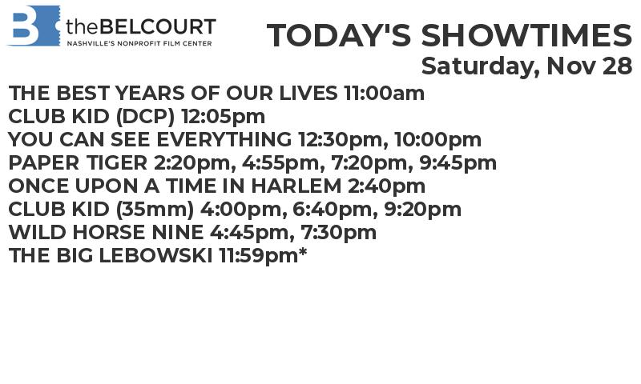

# inky-frame
Code powering my shiny new Inky Frame

Two projects are currently stored in this repository: 

* [`belcourt`](https://lindsay.codes/posts/webscraping-showtimes/) - a project that scrapes the Belcourt Theatre's website for the latest showtimes and displays them on the Inky Frame
* [`nashvillemta`](https://lindsay.codes/posts/realtime-bus-departure-board/) - a project queries the GTFS feed for the Nashville MTA bus system and displays the bus arrival times near a specific location on the Inky Frame

More details can be found at my website, linked to above.

## Setup

Python dependencies are managed with [uv](https://docs.astral.sh/uv/). `pyproject.toml` lists them and `uv.lock` pins every package (including indirect dependencies) to an exact version, so the daily GitHub Actions run installs the same versions every time.

```bash
# install uv: https://docs.astral.sh/uv/getting-started/installation/
uv sync                       # belcourt dependencies (Scrapy, Pillow, ...)
uv sync --group nashvillemta  # also the nashvillemta / analysis dependencies
```

Run the `belcourt` tests, spider and image generator:

```bash
uv run python -m unittest discover -s belcourt/tests -v
cd belcourt/belcourt/spiders && uv run scrapy runspider showtimes.py -O ../../output_showtimes.json
cd belcourt && uv run python belcourt_generate_image.py
```

To change a dependency, edit `pyproject.toml` (or use `uv add` / `uv remove`), then commit the updated `uv.lock`. To upgrade one package on purpose: `uv lock --upgrade-package <name>`.

The `belcourt/inky_frame_scripts/` files run in MicroPython on the Inky Frame itself and are not covered by uv.

Here is the latest output of the `belcourt` project:

